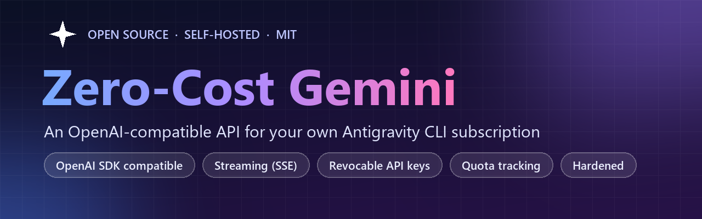
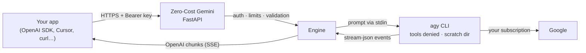

<div align="center">



<h3>Use the Gemini, Claude and GPT models from your own Antigravity CLI subscription<br>in any app that speaks the OpenAI API.</h3>

[](https://github.com/AbdulWaheedorg/Zero-Cost-Gemini/actions/workflows/ci.yml)
[](LICENSE)
[](https://www.python.org/)
[](https://fastapi.tiangolo.com/)
[](docs/API_REFERENCE.md)
[](docs/DEPLOYMENT.md)
[](#read-this-first)
[](CONTRIBUTING.md)
[](https://github.com/AbdulWaheedorg/Zero-Cost-Gemini/stargazers)

[Quickstart](#quickstart) · [How it works](docs/HOW_IT_WORKS.md) · [API reference](docs/API_REFERENCE.md) · [Deploy](docs/DEPLOYMENT.md) · [Security](docs/SECURITY_MODEL.md) · [Docs](docs/README.md)

</div>

---

<a id="read-this-first"></a>
## ⚠️ Read this first

> [!WARNING]
> **Unofficial project. Not affiliated with, endorsed by, or supported by Google.**
>
> Google's [Antigravity Additional Terms](https://antigravity.google/terms) (clause 6) list *"using third party software, tools, or services to access the Service"* as a breach, and say breaches can lead to *"suspension or termination of your Antigravity and/or Gemini CLI accounts."* This gateway runs the official CLI on your behalf, so **using it may violate those terms and put your account at risk.**
>
> - Use it only with **your own** account, for **your own** use. Don't resell or share access.
> - You alone are responsible for complying with Google's terms. This software is provided "as is", without warranty (see [LICENSE](LICENSE)).
> - Building a product for other people? Use the official [Gemini API](https://ai.google.dev/) instead.
>
> *Gemini, Antigravity and Google are trademarks of Google LLC. Claude and GPT are trademarks of their respective owners.*

---

## ✨ What is this?

**Zero-Cost Gemini** is a small, self-hosted gateway that turns Google's [Antigravity CLI](https://antigravity.google/product/antigravity-cli/) (`agy`) into a standard **OpenAI-compatible HTTP API**. Point any OpenAI SDK, coding assistant or chat UI at it, and requests run through *your* signed-in CLI, on the plan you already have. There's no separate per-token API bill for your personal use.

```text
your app ──OpenAI API──▶  Zero-Cost Gemini  ──stdin/stdout──▶  agy (your account)  ──▶  Google
```

It's built to be **safe to expose**: the CLI is an *agent* with shell and file tools, so the gateway locks those tools down, isolates every request, and puts hashed, revocable API keys in front of everything.

## 🚀 Features

| | |
| :--- | :--- |
| 🔌 **Drop-in OpenAI API** | `/v1/chat/completions` (streaming and non-streaming), `/v1/models`, OpenAI-shaped errors. Works with the official Python/Node SDKs, LangChain, Cursor, Continue, Open WebUI, LibreChat, n8n… |
| ⚡ **Real streaming** | Server-Sent Events token by token, `stream_options.include_usage`, usage mapping incl. reasoning and cached tokens |
| 🧭 **Dynamic models** | Discovers every model your plan offers (`agy models`) and refreshes every 30 minutes. New models appear automatically |
| 🔑 **Real API keys** | Named keys per app or device, stored as SHA-256 hashes, revoked instantly, managed by CLI or admin API |
| 📊 **Quota visibility** | 5-hour and weekly remaining quota per pool, on `/v1/quota` and in response headers |
| 🛡️ **Hardened by default** | Agent tools denied, isolated scratch dir per request, prompts over stdin, role-forgery-proof prompt encoding, concurrency and body limits, HTTPS-only, no public API explorer |
| 🧹 **Self-cleaning** | Idle/total timeouts, and the whole process tree is killed on timeout, error or client disconnect. No orphaned processes |
| 🧪 **Well tested** | ~100 hermetic tests with a fake CLI (no account needed), opt-in live tests, CI on Python 3.11–3.13 |
| 👥 **Optional multi-account** | Ordered failover between several of your own sign-ins ([read the warnings](docs/MULTI_ACCOUNT.md)) |

## 🧠 How it works



1. Your app sends a normal OpenAI request with a gateway API key.
2. The gateway checks the key and the limits, folds `messages` into one prompt (multi-turn history is JSON-encoded so it can't be spoofed), and starts `agy` in an empty scratch directory with the prompt on stdin.
3. `agy` streams `text_delta` events back; the gateway converts them into OpenAI chunks as they arrive.
4. When the answer is done, or the client disconnects, the `agy` process tree is killed and its directory deleted.

Full walkthrough: **[docs/HOW_IT_WORKS.md](docs/HOW_IT_WORKS.md)**.

<a id="quickstart"></a>
## 🏁 Quickstart

**You need:** Python 3.11+, git, and a Google account that can use the Antigravity CLI ([plans](https://antigravity.google/docs/plans)).

**1. Install the Antigravity CLI and sign in** (official installer, [docs](https://antigravity.google/docs/cli/install)):
```bash
# macOS / Linux
curl -fsSL https://antigravity.google/cli/install.sh | bash
```
```powershell
# Windows (PowerShell)
irm https://antigravity.google/cli/install.ps1 | iex
```
Run `agy` once and sign in (a browser opens; over SSH it prints a URL and asks for a code). Then check it with `agy models`.

**2. Install Zero-Cost Gemini**
```bash
git clone https://github.com/AbdulWaheedorg/Zero-Cost-Gemini.git
cd Zero-Cost-Gemini
python -m venv venv
source venv/bin/activate          # Windows: venv\Scripts\activate
pip install -r requirements.txt
```

**3. Create an API key** (printed once, so save it):
```bash
python -m src.keys create my-laptop
```

**4. Start the server**
```bash
uvicorn src.main:app --port 8200
```

**5. Try it**
```bash
curl http://127.0.0.1:8200/v1/chat/completions \
  -H "Authorization: Bearer sk-agy-YOUR-KEY" \
  -H "Content-Type: application/json" \
  -d '{"model": "gemini-3.8-flash-low", "messages": [{"role": "user", "content": "Say hello in five words."}]}'
```
🎉 That's it. To use it from anywhere, put it on a server behind HTTPS: **[Deployment guide](docs/DEPLOYMENT.md)** (systemd + Caddy, about 15 minutes).

## 💻 Use it from anything

**Python** (`pip install openai`)
```python
from openai import OpenAI

client = OpenAI(base_url="http://127.0.0.1:8200/v1", api_key="sk-agy-YOUR-KEY")

stream = client.chat.completions.create(
    model="gemini-3.8-flash-low",
    messages=[{"role": "user", "content": "Write a haiku about servers."}],
    stream=True,
)
for chunk in stream:
    if chunk.choices and chunk.choices[0].delta.content:
        print(chunk.choices[0].delta.content, end="", flush=True)
```

**JavaScript / TypeScript** (`npm install openai`)
```javascript
import OpenAI from "openai";

const client = new OpenAI({ baseURL: "http://127.0.0.1:8200/v1", apiKey: "sk-agy-YOUR-KEY" });
const r = await client.chat.completions.create({
  model: "gemini-3.8-flash-low",
  messages: [{ role: "user", content: "Name three planets." }],
});
console.log(r.choices[0].message.content);
```

**Apps and tools:** anything with an "OpenAI-compatible" or "custom base URL" setting:

| App | Setting |
| :--- | :--- |
| Cursor | Models → OpenAI API key + *Override OpenAI Base URL* → add a custom model name |
| Continue | `provider: openai`, `apiBase: https://api.example.com/v1`, `apiKey`, `model` |
| Open WebUI / LibreChat / Chatbox | Add an OpenAI-compatible connection with your base URL and key |
| LangChain | `ChatOpenAI(base_url="https://api.example.com/v1", api_key="…", model="…")` |
| n8n | OpenAI credential → *Base URL* |

<sub>App settings follow each app's own documentation and may change between versions.</sub>

## 📚 API at a glance

| Endpoint | Auth | Purpose |
| :--- | :--- | :--- |
| `POST /v1/chat/completions` | key | Chat, streaming or not |
| `GET /v1/models` · `GET /v1/models/{id}` | key | Available models |
| `GET /v1/quota` | key | Remaining 5-hour and weekly quota |
| `GET /healthz` | none | Liveness |
| `POST/GET /admin/keys` · `DELETE /admin/keys/{id}` | admin key | Create, list, revoke API keys |

Every chat response carries `X-Active-Account`, `X-Quota-5h-Remaining` and `X-Quota-Weekly-Remaining` headers. Full details, error codes and examples: **[API reference](docs/API_REFERENCE.md)**.

## 🔑 API keys

```bash
python -m src.keys create cursor-laptop   # one key per app/device
python -m src.keys list
python -m src.keys revoke key_603534026f4c   # stops working on the next request
```
Or over HTTP with an admin key: **[docs/API_KEYS.md](docs/API_KEYS.md)**.

## 🛡️ Security

The CLI behind this gateway is an AI agent with shell, file and web tools, so security is the main design concern:

- **Tools are denied.** `agy` runs without auto-approval, so headless mode refuses shell commands, file writes, file reads outside its scratch directory, and URL fetches. All of these were verified on a Linux server.
- **Isolated:** a fresh empty directory per request, prompts over stdin (never in `ps`), conversation history encoded so it can't impersonate system messages.
- **Keys:** 256-bit, stored hashed, revocable instantly. A separate admin key; no unauthenticated access.
- **Limits:** concurrency caps (total and per key), body size limit, timeouts, process-tree cleanup.
- **Edge:** HTTPS enforced behind Cloudflare, no `/docs` or `/openapi.json`, uniform OpenAI-style errors, secrets redacted from logs.

Threat model and what remains your responsibility: **[docs/SECURITY_MODEL.md](docs/SECURITY_MODEL.md)**. Found a vulnerability? See **[SECURITY.md](SECURITY.md)**.

## ⚖️ Good to know

- **Speed:** the first token usually takes 3–20 s (it's an agent CLI under the hood). Use `-low`/flash models for snappy replies, and set client timeouts of at least 5 minutes.
- **Not supported:** images/audio/files in messages (`400`), function calling (`tools` is ignored), `n > 1`. `temperature`, `max_tokens`, `stop` and `reasoning_effort` are accepted but ignored; pick a model variant (e.g. `-high`) for more reasoning.
- **Prompt tokens look high** (~10k even for "hi") because the CLI adds its own instructions; they count toward your quota.
- **Limits:** whatever your Google plan allows. Gemini models and Claude/GPT models have separate quota pools.

## ❓ FAQ

<details>
<summary><b>Is this allowed by Google?</b></summary>

Possibly not. See [Read this first](#read-this-first). The Antigravity terms prohibit accessing the service through third-party tools, and accounts can be suspended. Use it only with your own account, at your own risk. For anything you ship to other people, use the official Gemini API.
</details>

<details>
<summary><b>Is it really zero cost?</b></summary>

It doesn't add a per-token API bill: requests use the quota of the Antigravity plan you already have (the CLI is available on Google's free and paid plans, with different limits and models). Running the server is up to you.
</details>

<details>
<summary><b>Which models can I use?</b></summary>

Whatever `agy models` lists for your account. `GET /v1/models` always shows the live list, and Google adds and retires models over time ([model list](https://antigravity.google/docs/models)).
</details>

<details>
<summary><b>Does it work with Cursor / Continue / Open WebUI?</b></summary>

Yes: they all support a custom OpenAI base URL. Agent features that rely on function calling get plain text answers, since tool calls aren't supported.
</details>

<details>
<summary><b>Can I share my server with friends?</b></summary>

Please don't. Sharing access to your subscription is exactly what puts accounts at risk under Google's terms. Create keys for your own devices and apps.
</details>

<details>
<summary><b>Can it use several accounts?</b></summary>

There's an optional [multi-account mode](docs/MULTI_ACCOUNT.md) with failover. Read its warning first: rotating accounts to get around limits is the riskiest way to use this.
</details>

<details>
<summary><b>Do I need Docker?</b></summary>

No. The CLI is proprietary and can't be redistributed inside an image, so the project uses a plain Python install with a systemd service ([deployment](docs/DEPLOYMENT.md)).
</details>

## 📖 Documentation

| | |
| :--- | :--- |
| [How it works](docs/HOW_IT_WORKS.md) | Architecture, request lifecycle, streaming, error mapping |
| [API reference](docs/API_REFERENCE.md) | Endpoints, fields, headers, errors |
| [API keys](docs/API_KEYS.md) | Creating and revoking keys |
| [Configuration](docs/CONFIGURATION.md) | Every environment variable |
| [Deployment](docs/DEPLOYMENT.md) | Linux server, systemd, Caddy, Cloudflare |
| [Security model](docs/SECURITY_MODEL.md) | Threat model and agent-tool lockdown |
| [Multi-account mode](docs/MULTI_ACCOUNT.md) | Optional failover between your accounts |
| [Development](docs/DEVELOPMENT.md) | Tests, fake CLI, project layout |
| [Troubleshooting](docs/TROUBLESHOOTING.md) | Errors and fixes |

## 🤝 Contributing

Issues and pull requests are welcome! The test suite runs in seconds without any Google account. See **[CONTRIBUTING.md](CONTRIBUTING.md)**. If this project is useful to you, a ⭐ helps others find it.

## 📜 License

[MIT](LICENSE) © 2026 Abdul Waheed. Not affiliated with Google. Use at your own risk; see [Read this first](#read-this-first).

<div align="center">

[](https://star-history.com/#AbdulWaheedorg/Zero-Cost-Gemini&Date)

</div>
