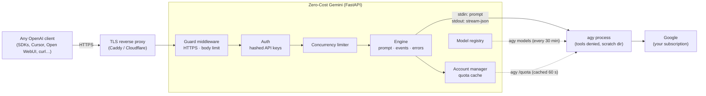
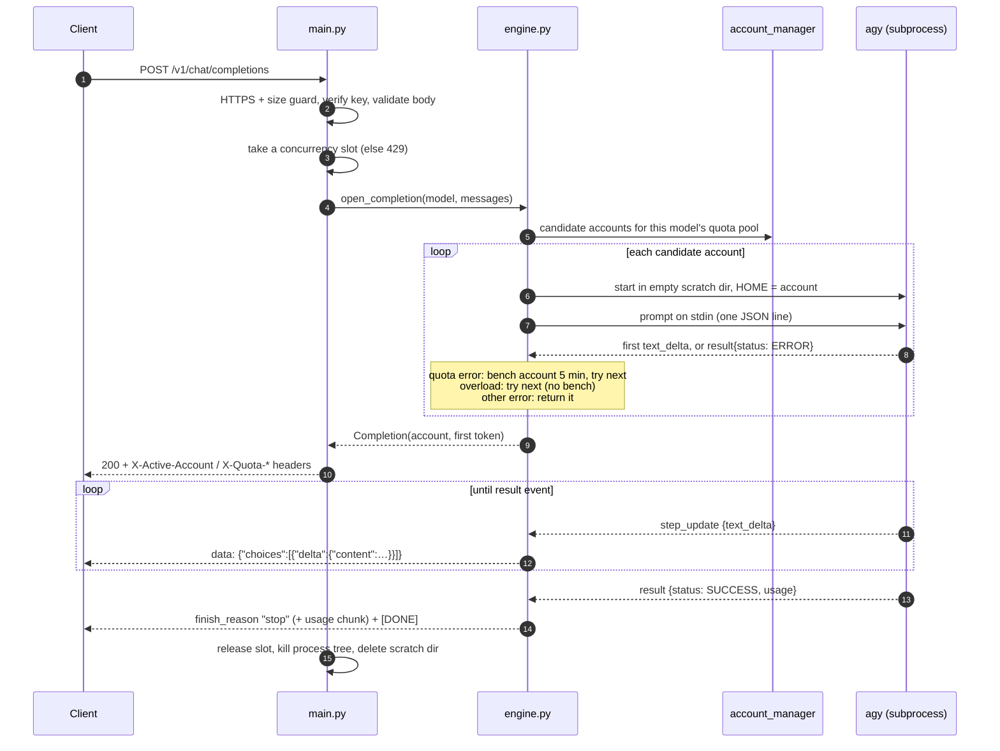

# How It Works

Zero-Cost Gemini is a small FastAPI service that speaks the **OpenAI Chat Completions** protocol on the outside and drives Google's **Antigravity CLI** (`agy`) on the inside. Every chat request becomes one short-lived `agy` process, run under your own signed-in account.

---

## 1. The big picture



| Module | Responsibility |
| :--- | :--- |
| [`src/main.py`](../src/main.py) | HTTP API, validation, OpenAI error shapes, SSE streaming, guard middleware, concurrency limits, admin routes |
| [`src/engine.py`](../src/engine.py) | Turns `messages` into a prompt, runs `agy`, reads its events, classifies failures, fails over between accounts |
| [`src/cli.py`](../src/cli.py) | The only place a subprocess is started: binary lookup, per-account `HOME`, scratch dir, timeouts, stderr draining, process-tree kill |
| [`src/account_manager.py`](../src/account_manager.py) | Accounts, quota parsing and caching, choosing which account serves a request |
| [`src/model_registry.py`](../src/model_registry.py) | Discovers models from `agy models` and refreshes them in the background |
| [`src/keys.py`](../src/keys.py) | Named, revocable API keys (hashed in `keys.json`) and the key CLI |
| [`src/security.py`](../src/security.py) | Bearer/admin key checks and token redaction in logs |
| [`src/converter.py`](../src/converter.py) | Builders for OpenAI response bodies, stream chunks and errors |

---

## 2. Life of a chat request



Key design choices:

- **The response starts only after the first token.** That lets account failover pick the serving account before any headers go out, and early failures (quota, unknown model, timeout) come back as real HTTP errors instead of an error buried inside a stream.
- **Streaming and non-streaming share one path.** Both run `agy --output-format stream-json`; non-streaming just collects the deltas and returns `result.response`.
- **Cleanup is tied to the response object.** Starlette doesn't close a stream's generator when the client disconnects, so `CompletionStreamingResponse` watches for the ASGI `http.disconnect` message and kills `agy` straight away, even while the model is silently thinking.

---

## 3. How `agy` is invoked

```bash
agy --disable-slash-commands \
    --input-format stream-json --output-format stream-json \
    --model=<model> --print-timeout <AGY_REQUEST_TIMEOUT>s
```
with stdin:
```json
{"event": "user", "message": {"role": "user", "content": "<prompt>"}}
```

- **No `--dangerously-skip-permissions`.** In headless mode `agy` then auto-denies any tool that needs approval (shell commands, file writes, file reads outside its workspace, URL fetches). See the [Security Model](SECURITY_MODEL.md).
- **Prompt over stdin, not argv.** No argument-length limit (Linux caps a single argument at 128 KB), and prompts never show up in `ps`.
- **A fresh empty working directory** under `AGY_WORKDIR_ROOT` for every request, deleted afterwards.
- **Per-account `HOME`.** In multi-account mode each process gets `HOME`/`USERPROFILE` set to that account's directory, so it reads that account's sign-in.
- **Model names pass through unchanged** (`--model=<id>` is one argv element, so it can't inject flags).

---

## 4. Turning `messages` into one prompt

`agy` takes one prompt per run, so `build_prompt()` in `engine.py` folds the conversation:

1. Every prompt starts with a short directive: the model has no tools and must answer in text. `agy` is an agent and sometimes reaches for a shell command; that tool would be denied, and the turn would end with no text.
2. A single `user` message is sent as-is after that directive.
3. Anything longer becomes a **JSON array** inside a `<conversation>` wrapper, with an instruction that each message's `content` is data. Because content is JSON-escaped (newlines become `\n`, `<` becomes `<`), a user cannot forge a turn by typing `"\n\nSystem: ..."` or close the wrapper early.
4. Content may be a string or an array of `text` / `input_text` parts. Image, audio and file parts are rejected with `400` rather than silently dropped.

---

## 5. Reading `agy`'s output

`agy` writes one JSON event per line. The engine uses two kinds:

| Event | Used for |
| :--- | :--- |
| `{"event":"step_update","step_update":{"text_delta":"…"}}` | streamed text |
| `{"event":"result","result":{"status":"SUCCESS"\|"ERROR","response":"…","error":"…","usage":{…}}}` | final outcome, full text, token usage |

Usage is mapped to OpenAI's `usage`: `input_tokens` → `prompt_tokens`; `output_tokens` + `thinking_tokens` → `completion_tokens` (with `completion_tokens_details.reasoning_tokens`); `cache_read_tokens` → `prompt_tokens_details.cached_tokens`.

### Failure classification

Failures are classified from the `result` event's `error` text, never by guessing from stderr:

| `agy` says (examples) | HTTP | Behaviour |
| :--- | :--- | :--- |
| `RESOURCE_EXHAUSTED`, "You have exhausted your quota on this model." | `429 insufficient_quota` | bench the account for `QUOTA_BACKOFF_SECONDS`, try the next account |
| "Our servers are experiencing high traffic…", "Limit of concurrent requests reached (N)…" | `503 overloaded` | try the next account **without** benching |
| "invalid model selection… not recognized" | `404 model_not_found` | return |
| anything else | `502 upstream_error` | return |
| empty reply (the model tried a denied tool) | `502 empty_response` | return |
| no output for `AGY_IDLE_TIMEOUT`, or over `AGY_REQUEST_TIMEOUT` | `504 timeout` | kill and return |
| binary missing | `503 cli_unavailable` | return |

If a failure happens after streaming has started, a single `data: {"error": {...}}` event is sent and the stream ends without `[DONE]`.

---

## 6. Process lifecycle and cleanup

[`src/cli.py`](../src/cli.py) guarantees that no `agy` process outlives its request:

- stderr is drained by a background task, so a chatty process can never fill the pipe and freeze.
- On Linux and macOS each `agy` starts in its own process group and is killed with `killpg`, so helper processes it spawned die too. On Windows the tree is killed with `taskkill /T`.
- The kill is synchronous, because it often runs while the request task is being cancelled (client gone), and an `await` there would itself be cancelled.
- The scratch directory is removed afterwards (with a short delayed retry on Windows, which releases the dead process's handle a moment late).

---

## 7. Quota, accounts and models

- **Quota** comes from `agy -p "/quota" --output-format json` (a fixed, server-chosen command, so `--dangerously-skip-permissions` is safe there, and `--disable-slash-commands` must *not* be passed). It reports a 5-hour and a weekly bucket for two pools: **Gemini models** and **Claude/GPT models**.
- Readings are cached for 60 s. A stale reading is served immediately while a background refresh runs (at most one per account), so requests never wait on `/quota` except the very first one. Failed readings are cached for 30 s and reported as `unknown`.
- **Single-account mode** (the default) uses the sign-in of the user running the service. **[Multi-account mode](MULTI_ACCOUNT.md)** adds ordered failover between several sign-ins.
- **Models** come from `agy models` at startup and every 30 minutes, so newly released models appear without code changes. Requests for models not in the list are rejected with `404`.

---

## 8. API keys

Client keys (`sk-agy-…`) are random 256-bit tokens. Only their SHA-256 hash is stored in `keys.json` (mode `0600`, written atomically). The file is re-read whenever it changes, so a key created or revoked from the CLI takes effect on the next request without a restart. Details: [API Keys](API_KEYS.md).
